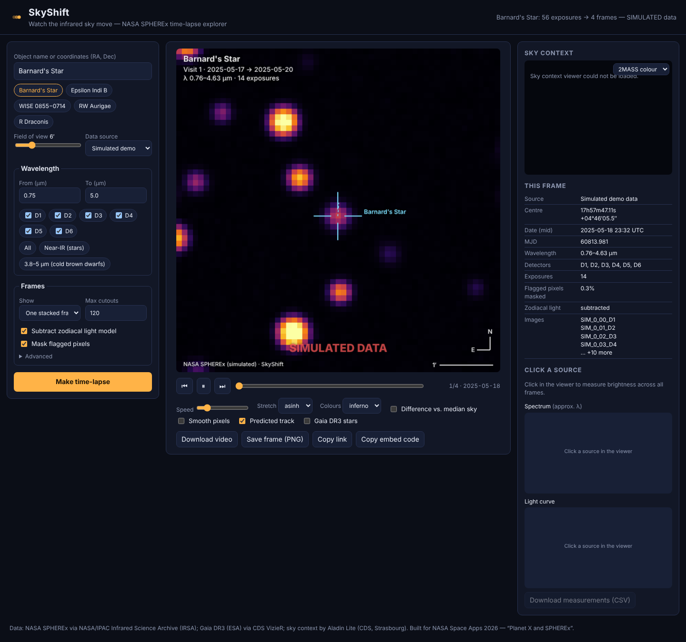

# SkyShift — watch the infrared sky move

**NASA Space Apps Challenge 2026 · Challenge: _Planet X and SPHEREx_ (Advanced · Astrophysics, Planets & Moons, Software)**

SkyShift is a public web tool. You type an object name or sky coordinates (RA/Dec), and it fetches every image of that spot from NASA's **SPHEREx** all-sky infrared survey. It lines the images up on a common north-up grid and plays them as a short time-lapse video. Anything that moves (nearby stars, brown dwarfs, asteroids, comets) or changes brightness (variable stars) stands out at a glance.



> ⚠️ **Space Apps Rule 01 (no early work):** building is only allowed on **14–15 November 2026**. This repository was created on 31 October 2026, before the hackathon. Before you submit it as your Space Apps project, read [docs/PLAN.md § Rules](docs/PLAN.md#rules--read-first) and decide with your team how to handle it. The safest option is to rebuild during the hackathon weekend and treat this repository as the design reference.

## What it does

| Challenge objective / consideration | SkyShift feature |
|---|---|
| Enter RA/Dec → series of images as a little video | Name/coordinate box (decimal or sexagesimal, CDS Sesame name resolver) → aligned time-lapse with play/scrub, plus **WebM/MP4 video download** |
| Make it easy to spot moving objects | **Difference vs. median sky** mode turns movers into blue/orange pairs. **Predicted-track overlay** propagates the target's proper motion to each frame's date. **Gaia DR3 overlay** propagates every catalogued star and highlights fast movers. |
| Test on Barnard's Star, Epsilon Indi B, WISE 0855, RW Aur, R Dra | One-click chips for all five, with positions and proper motions built in |
| Use the 102 bands / add detector arrays to boost S/N | Wavelength range and detector (D1–D6) filters. **One stacked frame per survey visit** coadds every exposure in that visit; **Every exposure** mode shows fast intra-visit motion such as asteroids. |
| Generate spectra on the fly | Click a source to run aperture photometry across every exposure, giving a **spectrum** (flux vs. λ) and a **light curve** (flux vs. time), both exportable as CSV. If you click the moving target, the aperture follows its predicted motion. |
| Add/subtract images | Visit coadds (add) and difference imaging (subtract) |
| Larger field of view | 2′–20′ field slider |
| Overlay other telescopes | Gaia DR3 (ESA) proper-motion overlay; Aladin Lite context panel with 2MASS, AllWISE, DSS2 and Pan-STARRS |
| Query by URL / embed | Every view is a shareable link (`?q=…&ra=…&dec=…&size=…&wmin=…&wmax=…&det=…&mode=…&diff=1`). **Copy embed code** gives an `<iframe>` (`&embed=1` shows the viewer only). |
| Show metadata like contamination flags | Per-frame table: dates, MJD, λ range, detectors, exposure count, % flagged pixels masked (bits read from the FLAGS header), zodiacal-light status, image IDs |
| Update quickly with new data releases | Nothing is pre-computed: every query asks the IRSA archive live, so new SPHEREx data appears automatically. The IRSA collection name is a setting. |

## How it works

```
name/RA,Dec ──► CDS Sesame (names) ──► proper-motion propagation to 2026.0 (field centre)
            ──► IRSA SIA v2 (ObsCore): every SPHEREx Level-2 spectral image covering the spot
            ──► filter by wavelength + detector, then evenly subsample to the cutout budget
            ──► IRSA cutout service: small multi-extension FITS per image (IMAGE, FLAGS, ZODI, …)
            ──► in browser: FITS parse → subtract ZODI → mask bad-pixel FLAGS
                ──► TAN-SIP WCS → bilinear reprojection onto a common north-up 6.15″/px grid
                ──► group into survey visits → coadd ──► stretch/colour map ──► animate / record
```

Everything runs in the browser with plain ES modules: no build step and no framework. `server.py` is optional. It serves the app and provides an allow-listed `/proxy` for archives that don't send CORS headers.

## Run it

```bash
python3 server.py
```

Then open <http://localhost:8000>. The app also works as static files (for example on GitHub Pages) wherever the archives allow cross-origin requests.

**Single-file version:** `dist/skyshift.html` contains the whole app and the team briefing in one file, so you can email it or double-click it. Rebuild it with `python3 scripts/build_standalone.py`.

To try it offline, choose **Data source → Simulated demo**. This generates realistic SPHEREx-like FITS files (TAN-SIP WCS, FLAGS, ZODI) containing a fast brown dwarf, a variable star and an asteroid. Every frame is watermarked **SIMULATED DATA**.

### Tests

```bash
npm test
```

```bash
npm run test:e2e
```

`npm test` runs the unit tests (FITS, WCS, photometry, parsing). The WCS is checked against astropy; regenerate the reference with `python3 tests/astropy_reference.py`. `npm run test:e2e` runs a Playwright browser test on simulated data.

## NASA and partner data

- **NASA SPHEREx** Level-2 spectral images — NASA/IPAC Infrared Science Archive (IRSA): SIA v2 `https://irsa.ipac.caltech.edu/SIA` (collection `spherex_qr`) and its cutout service
- **ESA Gaia DR3** (`I/355/gaiadr3`) via CDS VizieR — proper-motion overlay
- **CDS Sesame / SIMBAD** — name resolution
- **Aladin Lite v3** (CDS, Strasbourg) — sky context with 2MASS, AllWISE, DSS2 and Pan-STARRS HiPS

## Known limitations / next steps

- **Live archive not yet exercised end to end.** It was built in a sandbox with no network access to IRSA or CDS, so it was verified on simulated data and unit tests. On day 1, run one real query and check three things:
  - the SIA collection name (`spherex_qr` vs. a newer release)
  - the ObsCore column names (`access_url`, `t_min`, `em_min`, `em_max`, `energy_bandpassname`)
  - the cutout URL syntax (`?center=RA,DEC&size=DEG`)

  All three live in `app/js/providers/irsa.js`.
- **Spectral wavelength is approximate.** Each exposure gets the midpoint of its ObsCore wavelength range. SPHEREx's linear variable filters give each pixel its own wavelength, so the next step is to read the `WCS-WAVE` lookup table and use each pixel's exact λ.
- Tile-compressed FITS isn't supported (it isn't expected for IRSA cutouts).
- Ideas: automatic mover detection (dipole finder in difference images), JPL Horizons asteroid/comet predictions, and a WISE/NEOWISE time-series overlay for a 15-year baseline.

## Use of AI

This code and its documentation were drafted with Anthropic's Claude (Claude Code). The team must review, test and explain all of it, and should disclose this AI use on the Space Apps project page as the rules require.

## License

MIT
