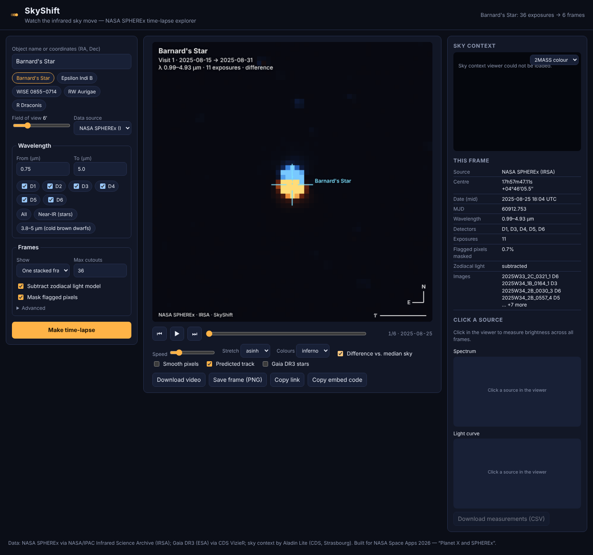

# SkyShift — watch the infrared sky move

**NASA Space Apps Challenge 2026 · Challenge: _Planet X and SPHEREx_ (Advanced · Astrophysics, Planets & Moons, Software)**

**Live demo: <https://mohammed200923-skyshift.hf.space>** (Hugging Face Space, real NASA SPHEREx data)

The site is a **3D sky** (interface by Ibrahim) running on the SkyShift engine; its **Analysis** button opens every tool described below on the selected target. See [docs/COMBINE.md](docs/COMBINE.md).

SkyShift is a public web tool. You type an object name or sky coordinates (RA/Dec), and it fetches every image of that spot from NASA's **SPHEREx** all-sky infrared survey. It lines the images up on a common north-up grid and plays them as a short time-lapse video. Anything that moves (nearby stars, brown dwarfs, asteroids, comets) or changes brightness (variable stars) stands out at a glance.



*Real SPHEREx data (IRSA DR1 + QR3): Barnard's Star in difference mode. 36 exposures, 6 visits between Aug 2025 and Sep 2026. The star sits within about 1 pixel of its predicted position in every visit.*

> ⚠️ **Space Apps Rule 01 (no early work):** building is only allowed on **14–15 November 2026**. This repository was created on 31 October 2026, before the hackathon. Before you submit it as your Space Apps project, read [docs/PLAN.md § Rules](docs/PLAN.md#rules--read-first) and decide with your team how to handle it. The safest option is to rebuild during the hackathon weekend and treat this repository as the design reference.

## What it does

| Challenge objective / consideration | SkyShift feature |
|---|---|
| Enter RA/Dec → series of images as a little video | Name/coordinate box (decimal or sexagesimal, CDS Sesame name resolver) → aligned time-lapse with play/scrub, plus **WebM/MP4 video download** |
| Find comets and asteroids | **Known asteroids & comets** (NASA JPL): for every exposure, every catalogued small body in the field at that moment is listed and circled, so a stacked visit shows its path. |
| Make it easy to spot moving objects | **Automatic mover search**: every field is searched on load. Sources are detected in each survey visit, linked across visits, corrected for alignment, and fitted with straight-line motion. Each mover is listed with its speed (″/yr), direction and uncertainty, and checked against Gaia DR3 and CatWISE2020. When the 2010 WISE image is loaded, each mover is **found again 15 years earlier** and its motion refitted: the uncertainty drops about 9× (e.g. WISE 0855: 8.23 ± 0.11″/yr, literature 8.15). **Difference vs. median sky** mode turns movers into blue/orange pairs. **Predicted-track overlay** propagates the target's proper motion to each frame's date. **Gaia DR3 overlay** propagates every catalogued star and highlights fast movers. |
| Test on Barnard's Star, Epsilon Indi B, WISE 0855, RW Aur, R Dra | One-click chips for all five, with positions and proper motions built in |
| Use the 102 bands / add detector arrays to boost S/N | Wide **and Deep Survey** images: near the ecliptic poles SPHEREx looks almost continuously (R Draconis: 2,494 images, monthly frames). Wavelength range and detector (D1–D6) filters. **One stacked frame per survey visit** coadds every exposure in that visit, weighted by each exposure's noise (from the VARIANCE plane). **Use all images** loads every matching exposure instead of an evenly spread sample; **Every exposure** mode shows fast intra-visit motion such as asteroids. |
| Generate spectra on the fly | Click a source, or a detected mover, to run aperture photometry across every exposure, with **error bars** from the VARIANCE plane. You get a **spectrum** (flux at each exposure's exact wavelength) and a **brightness-over-time** chart, both exportable as CSV. Each exposure is divided by the source's own brightness at that wavelength in other visits, so wavelength differences between visits don't masquerade as variability. The aperture follows the object's measured or predicted motion. |
| Add/subtract images | Visit coadds (add) and difference imaging (subtract) |
| Larger field of view | 2′–20′ field slider |
| Overlay other telescopes | **Gaia DR3** (ESA) stars moved to each frame's date. **NASA WISE**: the 2010 **AllWISE W2 (4.6 µm) image** opens the movie, a 15-year baseline, and **CatWISE2020** sources (WISE/NEOWISE motions, including cold brown dwarfs Gaia can't see) are drawn at each frame's date. Detected movers are checked against both Gaia DR3 and CatWISE2020. Aladin Lite context panel with 2MASS, AllWISE, DSS2 and Pan-STARRS. |
| Query by URL / embed | Every view is a shareable link (`?q=…&ra=…&dec=…&size=…&wmin=…&wmax=…&det=…&mode=…&diff=1`). **Copy embed code** gives an `<iframe>` (`&embed=1` shows the viewer only). |
| Show metadata like contamination flags | **Show masked pixels** highlights flagged pixels in magenta on the image. Per-frame table: dates, MJD, λ range, detectors, exposure count, % flagged pixels masked (bits read from the FLAGS header), zodiacal-light status, image IDs |
| Update quickly with new data releases | Nothing is pre-computed: every query asks the IRSA archive live, so new SPHEREx data appears automatically. The IRSA collection name is a setting. |

## How it works

```
name/RA,Dec ──► CDS Sesame (names) ──► proper-motion propagation to 2026.0 (field centre)
            ──► IRSA SIA v2 (ObsCore): every SPHEREx Level-2 spectral image covering the spot
            ──► filter by wavelength + detector, then evenly subsample to the cutout budget
            ──► IRSA cutout service: multi-extension FITS per image; the download stops after
                IMAGE, FLAGS, ZODI (~120 KB of ~4 MB, the rest is the PSF table)
            ──► in browser: FITS parse → subtract ZODI → mask artifact FLAGS (not bright-star flags)
                ──► exact wavelength at the target from the WCS-WAVE lookup (one table per detector)
                ──► TAN-SIP WCS → bilinear reprojection onto a common north-up 6.15″/px grid
                ──► group into survey visits → coadd ──► stretch/colour map ──► animate / record
```

Everything runs in the browser with plain ES modules: no build step and no framework. `server.py` is optional. It serves the app and provides an allow-listed `/proxy` for archives that don't send CORS headers.

## Run it

```bash
python3 server.py
```

Then open <http://localhost:8000>: it opens the 3D sky. Select a target and press **Analysis**, or go to <http://localhost:8000/?q=Barnard%27s%20Star>. The standalone analysis page is `/analysis.html`.

**The server caches what it fetches.** SPHEREx cutouts are trimmed on the server to the four planes the app uses (~120 KB instead of ~4 MB) and kept on disk (`SKYSHIFT_CACHE`, default 2 GB cap; archive searches refresh after 6 h). The first visitor to a field waits ~1 minute; the next one gets it in seconds. To warm a fresh deployment, load the challenge targets once: `BASE_URL=https://<your-site> node tests/live.mjs "Barnard's Star" "Epsilon Indi B" "WISE 0855−0714" "RW Aurigae" "R Draconis"`. **Use the server for real SPHEREx data:** IRSA sends no CORS headers, so a browser can't call it directly from a static page. The proxy is what makes live data work.

**Public hosting:** the repo has a `Dockerfile`; see [docs/DEPLOY.md](docs/DEPLOY.md) for Google Cloud Run or Azure (both are free Space Apps offers).

**Single-file version:** `dist/skyshift.html` contains the Analysis view and the team briefing in one file, so you can email it or double-click it. Rebuild it with `python3 scripts/build_standalone.py`.

To try it offline, choose **Data source → Simulated demo**. This generates realistic SPHEREx-like FITS files (TAN-SIP WCS, FLAGS, ZODI) containing a fast brown dwarf, a variable star and an asteroid. Every frame is watermarked **SIMULATED DATA**.

### Tests

```bash
npm test
```

```bash
npm run test:e2e
```

```bash
npm run test:live
```

`npm test` runs the unit tests (FITS, WCS, wavelength lookup, flags, photometry, parsing). The WCS and the per-pixel wavelength are checked against astropy, the wavelength on a fixture taken from a real SPHEREx cutout. `npm run test:e2e` runs a Playwright browser test on simulated data. `npm run test:live` loads Barnard's Star from the real archive and checks that the star follows its known proper motion.

## NASA and partner data

- **NASA JPL Small-Body Identification API**: known asteroids and comets in the field at each exposure's time
- **NASA WISE**: AllWISE Atlas images (IRSA SIA `wise_allwise`, W2, 2010), **NEOWISE** single exposures (IRSA SIA `neowiser`, W2, stacked per half-year visit 2014–2024) and the CatWISE2020 catalogue (IRSA TAP `catwise_2020`)
- **NASA SPHEREx** Level-2 spectral images — NASA/IPAC Infrared Science Archive (IRSA): SIA v2 `https://irsa.ipac.caltech.edu/SIA` (wide survey `spherex_dr1`, `spherex_qr3` and **Deep Survey** `spherex_dr1_deep`, `spherex_qr3_deep`) and its cutout service; the **SPHEREx DR1 all-sky HiPS cube** in the sky panel
- **ESA Gaia DR3** from **NASA MAST** (`Mast.Catalogs.GaiaDR3.Cone`, as linked by the challenge), with CDS VizieR mirrors as fallback
- **Partner data: NEOSSat** (Canadian Space Agency) observations of each field, from the Canadian Astronomy Data Centre (CAOM2 TAP), with preview images
- **SPHEREx EPSF** (point-spread functions): the server turns each detector's table into aperture corrections, so spectra account for light outside the aperture
- **CDS Sesame / SIMBAD** — name resolution
- **Aladin Lite v3** (CDS, Strasbourg) — sky context with 2MASS, AllWISE, DSS2 and Pan-STARRS HiPS


The 3D sky's stars: ESA Hipparcos (new reduction, van Leeuwen 2007, via VizieR I/311); star names from the HYG database v4.1 (CC BY-SA 4.0).

## Known limitations / next steps

- **Verified on the live archive (13 Nov 2026)** against IRSA's SPHEREx tutorial notebooks and real responses: collection names, ObsCore columns, cutout syntax, FLAGS bit names (`MSKNnnnn`) and the `WCS-WAVE` lookup.
- **All five challenge targets checked on real data (14 Nov).** The movers sit on their predicted tracks to within 0.6 px. See [docs/RESULTS.md](docs/RESULTS.md).
- **IRSA throttles bursts** (HTTP 503). The app retries with back-off, keeps 4 downloads in flight, and gives refused cutouts a second, one-at-a-time pass.
- **The mover search is tuned on five fields.** It found the three known fast movers with no false alarms (see [docs/RESULTS.md](docs/RESULTS.md)). Crowded fields and fainter movers need more testing, and measured speeds run 5–15% low.
- **Brightness over time is good to about ±10%** for a steady star; smaller variations aren't reliable yet. The monthly Deep Survey curve of R Draconis is still noisy. Saturated measurements (SPHEREx flags) are marked and excluded.
- **Error bars** come from the archive's VARIANCE plane after resampling. They ignore the correlated noise resampling introduces, so treat them as slightly optimistic.
- **Gaia overlay works**, falling back to VizieR mirrors (South Africa, Harvard) when the main CDS server is down. **The Aladin sky map** loads, but its image tiles were blocked in the test sandbox; check it on a normal connection.
- Tile-compressed FITS isn't supported (it isn't expected for IRSA cutouts).
- Ideas: automatic mover detection (dipole finder in difference images), JPL Horizons asteroid/comet predictions, and a WISE/NEOWISE time-series overlay for a 15-year baseline.

## Use of AI

This code and its documentation were drafted with Anthropic's Claude (Claude Code). The team must review, test and explain all of it, and should disclose this AI use on the Space Apps project page as the rules require.

## License

MIT
