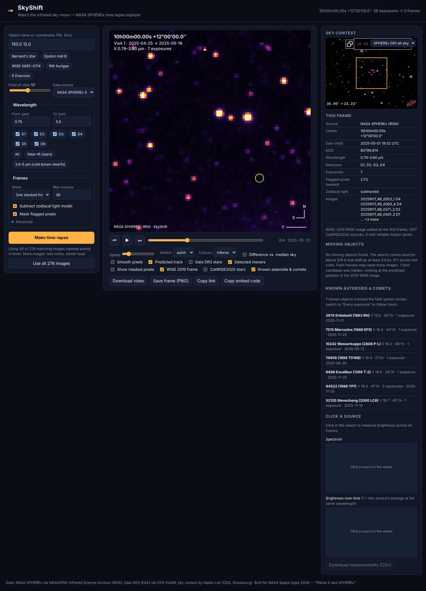

# Real-data results: the five challenge targets

Run on **14 November 2026** against the live NASA/IPAC archive (SPHEREx collections `spherex_dr1` + `spherex_qr3`) with `node tests/live.mjs <target>`. Up to 36 exposures were sampled evenly across all available SPHEREx images of each target and stacked into one frame per survey visit.

**How to read the tables**
- **Offset** is the distance between the brightest pixel near the target and where the target's catalogue proper motion predicts it should be on that date. One SPHEREx pixel is 6.15″. Values under about 1 px mean the target sits on its predicted track.
- **Flux** is aperture photometry at the predicted position. Each visit mixes different wavelengths, and stars are much brighter at some wavelengths than others. So flux changes between visits are only a first hint of variability, not a clean light curve. For a real light curve, click the star in the app and compare points of similar wavelength (colour = λ).
- Visits with only 1–3 exposures are noisy; faint targets may not be detected in them.

| Target | Visits | Moves as predicted? | Gaia DR3 overlay |
|---|---|---|---|
| Barnard's Star | 6 | ✅ within 0.41 px in the 3 well-covered visits | 1411 stars, Barnard's Star flagged as fast |
| Epsilon Indi B | 5 | ✅ within 0.6 px in every visit | 142 stars |
| WISE 0855−0714 (3.8–5 µm only) | 4 | ✅ within 0.57 px | 159 stars (WISE 0855 isn't in Gaia; it's too cold) |
| RW Aurigae | 3 | slow mover: stays put | 617 stars |
| R Draconis | 4 | slow mover: stays put | 106 stars |

## Automatic mover search (real data)

The app now searches every field for moving objects without being told where to look. Run on the same real SPHEREx data:

| Field | Images used | Movers found (confident) | Catalogue value | False alarms |
|---|---|---|---|---|
| Barnard's Star | 36 of 358 | 9.2 ± 0.9″/yr, matched to Gaia DR3 | 10.39″/yr | 0 |
| Epsilon Indi B | 36 of 463 | 4.0 ± 0.6″/yr, matched to Gaia DR3 | 4.68″/yr | 0 |
| WISE 0855−0714 (3.8–5 µm) | all 129 (93 at ≥3.8 µm at its position) | 8.4 ± 1.6″/yr (pmRA −8.1, pmDec +1.8), **no Gaia DR3 match** | 8.15″/yr (−8.12, +0.68) | 0 |
| RW Aurigae | 36 of 335 | none | slow mover | 0 |
| R Draconis | 36 of 540 | none | slow mover | 0 |

- **How false alarms are kept out.** Faint sources blended with neighbours appear to jump between visits (straight-line fit χ²ᵣ 14–90). True movers fit a straight line almost perfectly (χ²ᵣ 0.2–0.4). A confident mover must fit a line (χ²ᵣ ≤ 5), have significant motion (≥5σ, ≥0.8 px), a median S/N ≥ 8 and be seen in at least 4 visits. Tracks that pass the motion tests but are fainter are listed separately as "possible, check by eye".
- **WISE 0855 needs depth.** With 26 images it sits at S/N ≈ 5 and isn't found. With all available images it is found automatically, and flagged as having no Gaia DR3 match, which is what a genuinely new cold brown dwarf would look like. (A slow, unrelated Gaia star sits within 15″, so a mover is only matched to a Gaia star that also moves like it.)
- **Measured speeds run 5–15% low.** The likely cause is that positions in mixed-wavelength stacks are slightly pulled toward neighbouring sources. Still inside ~1–1.5σ.

## 16-year proper motions: SPHEREx + AllWISE 2010 + NEOWISE 2014–2024 (real data, 14 Nov)

The movie opens with 22 WISE frames: AllWISE 2010, then NEOWISE W2 every six months from 2014 to 2024 (5 single exposures median-stacked per visit). Each mover is found in every WISE frame, AllWISE first so its long lever arm pins the motion down, and refitted over up to 16 years.

| Target | SPHEREx alone | SPHEREx + WISE/NEOWISE | WISE epochs used | Published | Difference |
|---|---|---|---|---|---|
| Barnard's Star | 9.25 ± 0.87″/yr | **10.32 ± 0.10″/yr** (RA −0.86, Dec +10.29) | 18 of 22 | 10.39 (−0.80, +10.36), Gaia DR3 | **0.7%** |
| Epsilon Indi B | 4.00 ± 0.62″/yr | **4.65 ± 0.09″/yr** (RA +3.91, Dec −2.52) | 22 of 22 | 4.68, Gaia DR3 | **0.6%** |
| WISE 0855−0714 | 6.01 ± 1.65″/yr (below 4σ) | **8.39 ± 0.13″/yr** (RA −8.36, Dec +0.69) | 18 of 22 | 8.15 (−8.12, +0.68), Luhman & Esplin 2016 | 3% |

**False alarms with the wider candidate net:** none. RW Aurigae and R Draconis (25 and 37 frames with WISE) still show no movers.

Three problems found on the way and fixed:
- **Saturated stars.** In WISE/NEOWISE, Barnard's Star saturates into a ring with a flat core. Peak finding missed it or landed on the ring's edge, so the app now uses the light-weighted centre.
- **Error floor.** WISE positions got a 0.5 px error floor to allow for resampled pixels and saturation.
- **Epoch order.** Adding the closest epoch first let one wrong match derail the fit. AllWISE goes first now.

**WISE 0855 needs the WISE frames.** SPHEREx alone measures it at only 3.6σ, below the candidate threshold. With WISE frames loaded, ≥3σ tracks become candidates and are kept only if found in ≥2 WISE epochs and ≥5σ overall, and WISE 0855 is then confirmed in 18 epochs.

## SPHEREx PSF (EPSF) aperture corrections

From each detector's EPSF table (451 PSFs, 5× oversampled), the server computes the share of a star's light inside the 2-pixel photometry aperture; the app corrects each measurement at its exact wavelength. On Barnard's Star: 97.4% (D1, shortest λ) down to 95.7% (D4–D6), so spectra are corrected by 2.6–4.3%, more at long wavelengths.

## Partner data: NEOSSat (Canadian Space Agency)

For each field, CADC's archive is asked which NEOSSat observations cover it. Barnard's Star: **628 observations**, Nov 2018 – Dec 2019, shown with CADC preview images.

## Gaia DR3 from NASA MAST

Gaia DR3 now comes from NASA's MAST archive, the host the challenge links, in ~1–2 s; the server trims MAST's 153 columns (6.4 MB for Barnard's field) to the 6 used (237 KB). CDS VizieR mirrors remain the fallback.

## 15-year proper motions: SPHEREx + WISE 2010 only (earlier, 14 Nov)

Each confident mover is found again in the 2010 AllWISE image, at the position its SPHEREx motion predicts, and refitted. Static stars near the predicted spot are excluded, because they appear in the SPHEREx images too. The WISE point is accepted only if the motion stays a straight line.

| Target | SPHEREx alone | SPHEREx + WISE 2010 | Catalogue |
|---|---|---|---|
| Barnard's Star | 9.25 ± 0.87″/yr | **9.97 ± 0.10″/yr** | 10.39 (Gaia DR3) |
| Epsilon Indi B | 4.00 ± 0.62″/yr | **4.66 ± 0.10″/yr** (RA +3.94, Dec −2.49) | 4.68 (Gaia DR3) |
| WISE 0855−0714 | 8.35 ± 1.56″/yr | **8.23 ± 0.11″/yr** (RA −8.20, Dec +0.77) | 8.15 (−8.12, +0.68; Luhman & Esplin 2016) |

Uncertainties shrink about 9×. Epsilon Indi B and WISE 0855 agree with the catalogues to 1–2%. Barnard's Star is 4% low, likely because it is heavily saturated in WISE W2, which biases its measured centre.

In the Epsilon Indi B field, two faint "possible" candidates had nothing at their predicted 2010 position and are hidden. The app says so in the movers panel.

## Deep Survey (real data)

Near the ecliptic poles, SPHEREx observes almost continuously. R Draconis has **2,494 images** (540 wide + 1,954 deep) covering every month from April 2025 to September 2026, now shown as ~15 monthly frames (visits are capped at 30 days).

- **Mover search:** on 15 visits, a bright star's optical ghost lined up in 4 visits and passed as a "mover" (50″/yr). Movers must now be seen in at least half of the visits; possibles in at least a third. After that, all seven saved test fields are clean.
- **Light curve:** the monthly R Draconis curve is still noisy (0.5–1.6 month to month, often from only 2–8 exposures), with no clean pulsation cycle. It is **not reliable yet**; the earlier three-visit numbers below should be read with the same caution. R Draconis is *not* flagged as saturated.

## Saturation

SPHEREx's own OVERFLOW/NONLINEAR flags are now carried to each measurement. Saturated measurements are drawn hollow, left out of brightness over time, and announced. RW Aurigae: 15 of 36 measurements saturated. Barnard's Star, R Draconis, WISE 0855: none.

## Known asteroids and comets (NASA JPL)

Two NASA JPL services work together:
1. **Small-Body Identification** lists candidate asteroids and comets (V ≤ 20) near the field, once per observing day. It takes ~20 s per request whatever the box size; its fast mode can be off by a few arcminutes.
2. **Horizons** then gives each candidate's exact position at every exposure time, in well under a second per object.

On an ecliptic test field (RA 150°, Dec +12°, 10′, 36 sampled exposures), **4 known asteroids** fell inside the sampled exposures (V 18.5–19.4), circled at their Horizons positions. They take ~2 minutes after the images load. Asteroids at V 18–19 are at or below a single SPHEREx exposure's depth, so the circles mark where they are; they aren't always visible. A brighter one, 3674 Erbisbuhl (V 15.8), crossed the field in exposures that weren't in the 36-image sample: "Use all images" includes them.

The precise mode alone (per exposure) found 7 objects but took ~10 minutes, too slow for a live demo.

## WISE comparison (real data)

The 2010 AllWISE W2 (4.6 µm) image opens each movie, and CatWISE2020 sources are overlaid. Detected movers are checked against Gaia DR3 first, then CatWISE2020.

| Field | WISE 2010 frame | CatWISE2020 sources | With reliable motion | Mover check |
|---|---|---|---|---|
| Barnard's Star | ✅ star ~2.5′ south of its 2026 position, on the predicted track | 1,050 | 0 (139 before clean-up: all glare from Barnard's Star) | Gaia DR3 10.39″/yr |
| Epsilon Indi B | ✅ | 518 | 2 | Gaia DR3 4.68″/yr |
| WISE 0855−0714 | ✅ faint source at the predicted 2010 position, where SkyShift's measured motion extrapolates | 737 | 2 (WISE 0855 among them) | **CatWISE2020 8.09″/yr** (not in Gaia) |
| RW Aurigae | ✅ | 874 | 0 | – |

**Rules for "reliable motion"** in CatWISE: at least 0.3″/yr and 8σ, W2 S/N ≥ 20, outside the glare zones of bright Gaia stars (220″ for G ≤ 9, 100″ for G ≤ 11), with duplicate entries of the same mover merged.

## Brightness over time (real data, 60 images each)

Each exposure is divided by the source's own brightness at the same wavelength in the other visits, so a steady star should sit at 1. Values are per-visit medians; visits with only 1–2 exposures are left out here because they're much noisier.

| Star | Visit-to-visit relative brightness | Reading |
|---|---|---|
| Barnard's Star (steady) | 1.04 → 0.89 → 0.98 | Steady to about ±10%: this is the method's current noise level |
| RW Aurigae (young, irregular variable) | 0.88 → 1.09 → 1.00 | ~20% change: a modest detection |
| R Draconis (Mira variable) | 0.73 → 1.74 → 1.16 | Looks variable, but the monthly Deep Survey curve is noisy (see above): treat as unconfirmed |

Before this correction, raw fluxes mixed wavelengths between visits and could mislead. For example, R Draconis seemed to drop from 20,900 to 13,400 mJy partly because the later visit sampled different wavelengths.

## Barnard's Star

| Visit date | Exposures | λ (µm) | Offset (px) | Flux at target (mJy) |
|---|---|---|---|---|
| 2025-08-25 | 11 | 0.99–4.93 | 0.41 | 5230 |
| 2025-09-30 | 1 | 0.84–0.84 | 1.13 | 1570 |
| 2026-03-16 | 11 | 0.99–4.86 | 0.35 | 6290 |
| 2026-05-04 | 1 | 4.86–4.86 | 0.43 | 3400 |
| 2026-08-22 | 11 | 1.14–4.60 | 0.11 | 6060 |
| 2026-09-22 | 1 | 4.29–4.29 | 0.24 | 4520 |

## Epsilon Indi B

| Visit date | Exposures | λ (µm) | Offset (px) | Flux at target (mJy) |
|---|---|---|---|---|
| 2025-04-28 | 7 | 1.56–4.42 | 0.52 | 26.5 |
| 2025-06-07 | 3 | 1.89–4.38 | 0.43 | 30.9 |
| 2025-10-12 | 11 | 0.78–4.64 | 0.17 | 20.5 |
| 2026-04-25 | 5 | 0.77–3.83 | 0.24 | 18.3 |
| 2026-09-27 | 10 | 1.35–4.94 | 0.6 | 29.9 |

## WISE 0855−0714

| Visit date | Exposures | λ (µm) | Offset (px) | Flux at target (mJy) |
|---|---|---|---|---|
| 2025-05-06 | 3 | 4.04–4.97 | 0.15 | 0.294 |
| 2025-11-09 | 12 | 3.82–4.98 | 0.19 | 0.604 |
| 2025-12-12 | 2 | 4.19–4.70 | 0.07 | 0.669 |
| 2026-05-01 | 9 | 3.83–4.90 | 0.57 | 0.503 |

## RW Aurigae

| Visit date | Exposures | λ (µm) | Offset (px) | Flux at target (mJy) |
|---|---|---|---|---|
| 2025-09-10 | 12 | 0.78–4.57 | 0 | 662 |
| 2026-03-02 | 12 | 0.79–4.94 | 0 | 1030 |
| 2026-09-11 | 12 | 0.75–4.49 | 0 | 673 |

## R Draconis

| Visit date | Exposures | λ (µm) | Offset (px) | Flux at target (mJy) |
|---|---|---|---|---|
| 2025-06-17 | 10 | 0.92–4.44 | 1 | 16200 |
| 2025-11-24 | 14 | 0.78–4.80 | 1.41 | 18800 |
| 2026-05-07 | 5 | 1.68–4.70 | 1 | 20900 |
| 2026-07-01 | 7 | 1.01–4.58 | 1.42 | 13400 |

