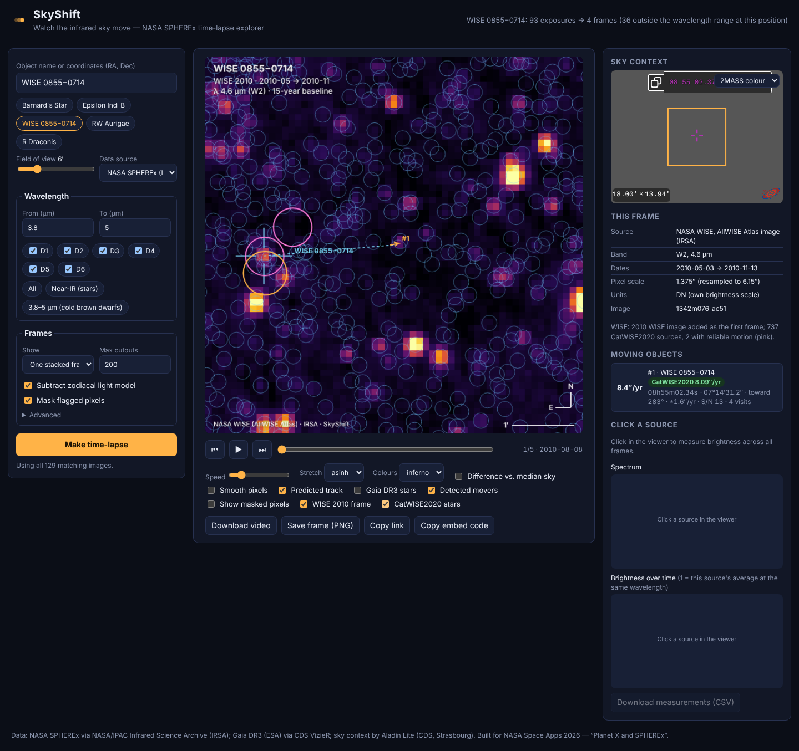
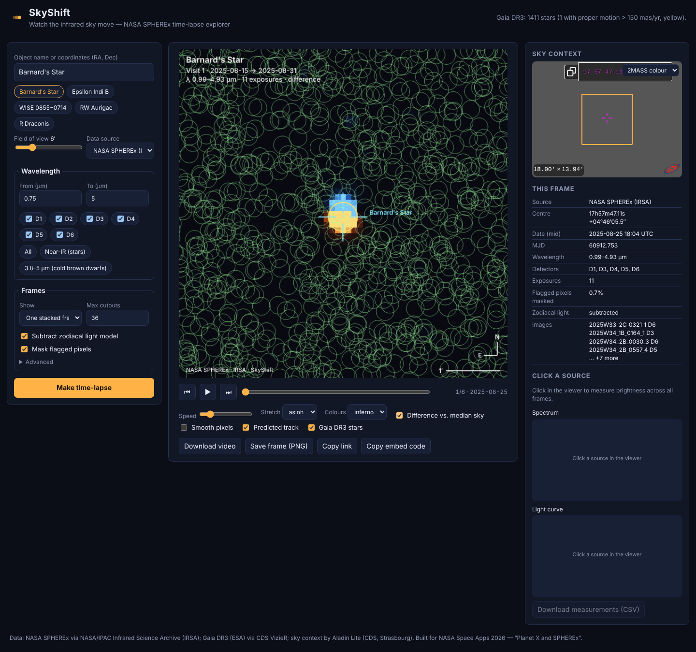

# Real-data results: the five challenge targets

Run on **14 November 2026** against the live NASA/IPAC archive (SPHEREx collections `spherex_dr1` + `spherex_qr3`) with `node tests/live.mjs <target>`. Up to 36 exposures were sampled evenly across all available SPHEREx images of each target and stacked into one frame per survey visit.

**How to read the tables**
- **Offset** is the distance between the brightest pixel near the target and where the target's catalogue proper motion predicts it should be on that date. One SPHEREx pixel is 6.15″. Values under about 1 px mean the target sits on its predicted track.
- **Flux** is aperture photometry at the predicted position. Each visit mixes different wavelengths, and stars are much brighter at some wavelengths than others. So flux changes between visits are only a first hint of variability, not a clean light curve. For a real light curve, click the star in the app and compare points of similar wavelength (colour = λ).
- Visits with only 1–3 exposures are noisy; faint targets may not be detected in them.

| Target | Visits | Moves as predicted? | Gaia DR3 overlay |
|---|---|---|---|
| Barnard's Star | 6 | ✅ within 0.41 px in the 3 well-covered visits | 1411 stars, Barnard's Star flagged as fast |
| Epsilon Indi B | 5 | ✅ within 0.6 px in every visit | 142 stars |
| WISE 0855−0714 (3.8–5 µm only) | 4 | ✅ within 0.57 px | 159 stars (WISE 0855 isn't in Gaia; it's too cold) |
| RW Aurigae | 3 | slow mover: stays put | 617 stars |
| R Draconis | 4 | slow mover: stays put | 106 stars |

## Automatic mover search (real data)

The app now searches every field for moving objects without being told where to look. Run on the same real SPHEREx data:

| Field | Images used | Movers found (confident) | Catalogue value | False alarms |
|---|---|---|---|---|
| Barnard's Star | 36 of 358 | 9.2 ± 0.9″/yr, matched to Gaia DR3 | 10.39″/yr | 0 |
| Epsilon Indi B | 36 of 463 | 4.0 ± 0.6″/yr, matched to Gaia DR3 | 4.68″/yr | 0 |
| WISE 0855−0714 (3.8–5 µm) | all 129 (93 at ≥3.8 µm at its position) | 8.4 ± 1.6″/yr (pmRA −8.1, pmDec +1.8), **no Gaia DR3 match** | 8.15″/yr (−8.12, +0.68) | 0 |
| RW Aurigae | 36 of 335 | none | slow mover | 0 |
| R Draconis | 36 of 540 | none | slow mover | 0 |

- **How false alarms are kept out.** Faint sources blended with neighbours appear to jump between visits (straight-line fit χ²ᵣ 14–90). True movers fit a straight line almost perfectly (χ²ᵣ 0.2–0.4). A confident mover must fit a line (χ²ᵣ ≤ 5), have significant motion (≥5σ, ≥0.8 px), a median S/N ≥ 8 and be seen in at least 4 visits. Tracks that pass the motion tests but are fainter are listed separately as "possible, check by eye".
- **WISE 0855 needs depth.** With 26 images it sits at S/N ≈ 5 and isn't found. With all available images it is found automatically, and flagged as having no Gaia DR3 match, which is what a genuinely new cold brown dwarf would look like. (A slow, unrelated Gaia star sits within 15″, so a mover is only matched to a Gaia star that also moves like it.)
- **Measured speeds run 5–15% low.** The likely cause is that positions in mixed-wavelength stacks are slightly pulled toward neighbouring sources. Still inside ~1–1.5σ.

## WISE comparison (real data)

The 2010 AllWISE W2 (4.6 µm) image opens each movie, and CatWISE2020 sources are overlaid. Detected movers are checked against Gaia DR3 first, then CatWISE2020.

| Field | WISE 2010 frame | CatWISE2020 sources | With reliable motion | Mover check |
|---|---|---|---|---|
| Barnard's Star | ✅ star ~2.5′ south of its 2026 position, on the predicted track | 1,050 | 0 (139 before clean-up: all glare from Barnard's Star) | Gaia DR3 10.39″/yr |
| Epsilon Indi B | ✅ | 518 | 2 | Gaia DR3 4.68″/yr |
| WISE 0855−0714 | ✅ faint source at the predicted 2010 position, where SkyShift's measured motion extrapolates | 737 | 2 (WISE 0855 among them) | **CatWISE2020 8.09″/yr** (not in Gaia) |
| RW Aurigae | ✅ | 874 | 0 | – |

**Rules for "reliable motion"** in CatWISE: at least 0.3″/yr and 8σ, W2 S/N ≥ 20, outside the glare zones of bright Gaia stars (220″ for G ≤ 9, 100″ for G ≤ 11), with duplicate entries of the same mover merged.

## Brightness over time (real data, 60 images each)

Each exposure is divided by the source's own brightness at the same wavelength in the other visits, so a steady star should sit at 1. Values are per-visit medians; visits with only 1–2 exposures are left out here because they're much noisier.

| Star | Visit-to-visit relative brightness | Reading |
|---|---|---|
| Barnard's Star (steady) | 1.04 → 0.89 → 0.98 | Steady to about ±10%: this is the method's current noise level |
| RW Aurigae (young, irregular variable) | 0.88 → 1.09 → 1.00 | ~20% change: a modest detection |
| R Draconis (Mira variable) | **0.73 → 1.74 → 1.16** | A factor of 2.4: clear variability |

Before this correction, raw fluxes mixed wavelengths between visits and could mislead. For example, R Draconis seemed to drop from 20,900 to 13,400 mJy partly because the later visit sampled different wavelengths.

## Barnard's Star

| Visit date | Exposures | λ (µm) | Offset (px) | Flux at target (mJy) |
|---|---|---|---|---|
| 2025-08-25 | 11 | 0.99–4.93 | 0.41 | 5230 |
| 2025-09-30 | 1 | 0.84–0.84 | 1.13 | 1570 |
| 2026-03-16 | 11 | 0.99–4.86 | 0.35 | 6290 |
| 2026-05-04 | 1 | 4.86–4.86 | 0.43 | 3400 |
| 2026-08-22 | 11 | 1.14–4.60 | 0.11 | 6060 |
| 2026-09-22 | 1 | 4.29–4.29 | 0.24 | 4520 |

## Epsilon Indi B

| Visit date | Exposures | λ (µm) | Offset (px) | Flux at target (mJy) |
|---|---|---|---|---|
| 2025-04-28 | 7 | 1.56–4.42 | 0.52 | 26.5 |
| 2025-06-07 | 3 | 1.89–4.38 | 0.43 | 30.9 |
| 2025-10-12 | 11 | 0.78–4.64 | 0.17 | 20.5 |
| 2026-04-25 | 5 | 0.77–3.83 | 0.24 | 18.3 |
| 2026-09-27 | 10 | 1.35–4.94 | 0.6 | 29.9 |

## WISE 0855−0714

| Visit date | Exposures | λ (µm) | Offset (px) | Flux at target (mJy) |
|---|---|---|---|---|
| 2025-05-06 | 3 | 4.04–4.97 | 0.15 | 0.294 |
| 2025-11-09 | 12 | 3.82–4.98 | 0.19 | 0.604 |
| 2025-12-12 | 2 | 4.19–4.70 | 0.07 | 0.669 |
| 2026-05-01 | 9 | 3.83–4.90 | 0.57 | 0.503 |

## RW Aurigae

| Visit date | Exposures | λ (µm) | Offset (px) | Flux at target (mJy) |
|---|---|---|---|---|
| 2025-09-10 | 12 | 0.78–4.57 | 0 | 662 |
| 2026-03-02 | 12 | 0.79–4.94 | 0 | 1030 |
| 2026-09-11 | 12 | 0.75–4.49 | 0 | 673 |

## R Draconis

| Visit date | Exposures | λ (µm) | Offset (px) | Flux at target (mJy) |
|---|---|---|---|---|
| 2025-06-17 | 10 | 0.92–4.44 | 1 | 16200 |
| 2025-11-24 | 14 | 0.78–4.80 | 1.41 | 18800 |
| 2026-05-07 | 5 | 1.68–4.70 | 1 | 20900 |
| 2026-07-01 | 7 | 1.01–4.58 | 1.42 | 13400 |

